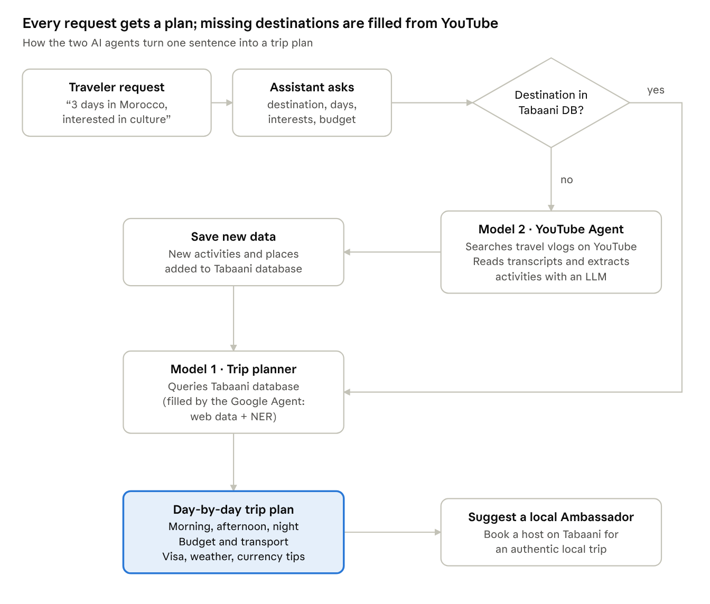

# AI Trip Planner – Tabaani

**Turn one sentence into a day-by-day trip plan.**
"3 days in Morocco, interested in culture" → a personalized itinerary with activities, timings, budget, transport and travel tips.

> Built during a 3-month internship at **Tabaani** (06/2022 – 09/2022), a travel platform for the Arab world that connects travelers with local hosts ("Ambassadors").
> **My role:** Team lead of the Egyptian team — wrote the product spec and backlog, and built the AI agents as a Data Scientist.

---

## The problem

- Planning a trip means hours of jumping between Google, YouTube vlogs and blogs.
- Generic itineraries ignore the traveler's interests, budget and number of days.
- Structured travel data for many Arab destinations is limited.

## The solution

A chat assistant asks four questions (destination, days, interests, budget), then builds the plan:

1. **Destination already in Tabaani's database?** → **Model 1 (Trip Planner)** builds the itinerary from Tabaani data, collected by the **Google Agent**.
2. **Destination missing?** → **Model 2 (YouTube Agent / "TripTuber")** searches travel vlogs, reads transcripts, extracts activities with an LLM and saves them to the database. Then the plan is built.
3. The traveler gets a **day-by-day plan** (morning / afternoon / night, budget, transport, visa, weather and currency tips) and a suggestion to **book a local Ambassador** on Tabaani.

Every missing destination makes the database bigger, so coverage grows with use.

📄 **Full product case study:** [AI_Trip_Planner_Product_Case_Study.pdf](AI_Trip_Planner_Product_Case_Study.pdf) — problem, personas, MVP scope, epics and user stories, success metrics, roadmap, risks and lessons learned.

## Target users

| Persona | Needs |
|---|---|
| **Culture explorer** – first trip to the region, plans online | A short, logical plan around her interests, with a budget estimate |
| **Busy family planner** – little time, travels with kids | Family-friendly activities, sensible travel times, practical info in one place |

## MVP scope

| In the MVP | Later |
|---|---|
| Chat input: destination, days, interests, budget | Accounts and saved trips |
| Day-by-day itinerary with budget and transport | Drag-and-drop editing |
| Google Agent + YouTube Agent | Real-time weather and closure alerts |
| Ambassador booking prompt | In-app booking and payments |

## Success metrics (proposed)

- **North Star:** trip plans accepted (saved or shared) per week
- % of chats that reach a finished itinerary
- Plan rating (1–5) and % of plans heavily edited
- Ambassador booking click-through from a plan
- Time to generate a plan

## Roadmap

| Phase | Focus |
|---|---|
| **MVP** | Prove AI can plan a good trip from Tabaani + YouTube data |
| **V2** | Accounts, editing, route and opening-hours optimization |
| **V3** | Real-time alerts, local events, Ambassador booking in the flow |

## Product documents

- `AI_Trip_Planner_Product_Case_Study.pdf` – full product case study
- `Specification Document_ Intelligent Trip Planning Feature.pdf` – objectives, features, user flow, epics, user stories and sprint plan
- `Creating an AI Agent for Tabaani.pdf` – agent architecture and assistant behavior

---

## How it's built (technical details)

**Google Agent** – `google_agent_database.ipynb`
- Web scraping + Gemini to collect destination content
- Text cleaning and stop-word removal
- Named Entity Recognition with spaCy and NLTK; custom rule-based activity extraction
- LocationTagger to detect countries, cities and regions
- Results stored in a database for plan generation

**YouTube Agent** – `Youtube_Agent.ipynb`
- YouTube API search and filtering for travel videos
- Transcript extraction and cleaning
- LLaMA to extract activities, locations and countries

**Tech:** Python · OpenAI API (function calling, knowledge retrieval) · Gemini · LLaMA · spaCy · NLTK · LocationTagger · YouTube Data API

## What I learned

- Writing the spec, epics and sprint backlog first kept two teams aligned on one goal.
- The Ambassador prompt connected a technical demo to Tabaani's business model.
- Next time I'd test the question flow with real travelers in week 1, before building the agents.
